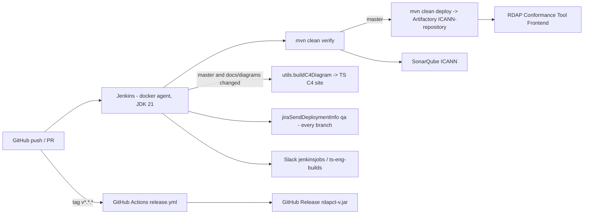

# RDAP Conformance Tool - Architecture

Detailed reference for how `rdapct` is built. The [README](../README.md) is the fast-start and
operational summary; this document is authoritative where they overlap. Claims below were checked
against the code, `pom.xml`, `Dockerfile` and `Jenkinsfile` as of version **4.0.1**. Behavioural
detail (step-by-step execution) lives in [`process_flow.md`](process_flow.md); test
codes in [`codes.md`](codes.md).

Logging conventions are in [`logging-info.md`](logging-info.md).

## C4 diagrams

C4-PlantUML sources live in [`diagrams/`](diagrams/). Render locally with any PlantUML server or
`plantuml -tsvg docs/diagrams/*.puml`. The Jenkins `Publish C4` stage publishes them to the TS C4
site whenever `docs/diagrams` changes on `master`, or on demand with the `FORCE_C4_PUBLISH=true`
build parameter (`Jenkinsfile:51-57`). The parameter is only honoured on `master`, and
`hasPathChanged` diffs `HEAD^ HEAD`, so only the **last commit** is inspected; after a
rebase-merge whose final commit does not touch `docs/diagrams`, run the job with
`FORCE_C4_PUBLISH=true`.

| Level | File | Covers |
|---|---|---|
| L1 | [`context.puml`](diagrams/context.puml) | §1 Overview |
| L2 | [`container.puml`](diagrams/container.puml) | §2 Modules, §6 Filesystem artefacts |
| L3 | [`component.puml`](diagrams/component.puml) | §3 Package map, §4 Data flow |

The C4 views are **structural**. §4 is **behavioural**. **Changing the architecture means
updating this document and the diagrams in the same pull request.**

## 1. Overview

`rdapct` is a stand-alone Java 21 / Maven multi-module application (`pom.xml:13-15`) owned by
ICANN Technical Services. It acts as a test suite: given an RDAP URI and a *definition file*,
it issues HTTPS queries over IPv4 and IPv6 with both `application/json` and
`application/rdap+json`, validates every response against RDAP JSON schemas (RFC 7480-7484) and
the ICANN gTLD RDAP Profile (February 2024), and writes a JSON results file.

- **In:** CLI arguments (picocli), definition file (`-c`), IANA datasets (HTTPS), target RDAP
  server responses, optional local JSON file (`file://` URI).
- **Out:** `results/results-<timestamp>.json`, process exit code (`ToolResult`), logs on stdout.
- **No server, no database, no message broker.** Single-shot process. A thread-safe embeddable
  API (`RdapWebValidator`) exists for the RDAP Conformance Tool Frontend.

## 2. Modules

| Module | Artifact | Packaging | Role |
|---|---|---|---|
| `jitpack` | `org.icann.rdap-conformance:jitpack` | pom | Declares `jitpack.io` repository and the `org.everit.json.schema` 1.12.2 dependency (`jitpack/pom.xml`) |
| `validator` | `org.icann.rdap-conformance:validator` | jar | Validation engine library. Depends on SLF4J API only (`validator/pom.xml:46`); `slf4j-simple` is test scope |
| `tool` | `org.icann.rdap-conformance:tool` -> shaded **`rdapct-<version>.jar`** | jar | CLI (picocli 4.6.1) + logback-classic 1.5.13 binding (`tool/pom.xml:42-48`). `Main` is the entry point |

Version is a single property: `rdap-conformance.version` in the parent `pom.xml:27`
(flattened by `flatten-maven-plugin` into `.flattened-pom.xml`).

## 3. Package map

Root packages: `org.icann.rdapconformance.tool` and `org.icann.rdapconformance.validator`.

### tool

| Class / package | Responsibility |
|---|---|
| `Main` | `main()`; delegates to picocli `CommandLine(new RdapConformanceTool())` |
| `RdapConformanceTool` | `@Command` + `Callable<Integer>`. Options (`-c`, `--timeout`, `--maximum-redirects`, `--use-local-datasets`, `--additional-conformance-queries`, `--logging`, `-v`, `--dns-resolver`, `--ssrf-allowed-hosts`, `--no-ipv4-queries`, `--no-ipv6-queries`, `--use-rdap-profile-february-2024`, `--gtld-registrar`, `--gtld-registry`, `--thin`). Configures logback programmatically (§7), TLS system properties (`:473-477`), progress, then runs the workflow |
| `LoggingLevel` | `CLI`, `INFO`, `DEBUG`, `ERROR`, `VERBOSE` |
| `UserInputValidator` | Validates URI / option combinations before any network I/O |
| `VersionProvider` | `--version` from `version.properties` |
| `RdapWebValidator` | Embeddable, `AutoCloseable`, thread-safe entry point; does **not** touch global logging/TLS state. Constructors: boolean flags (`:83-154`) or a caller-supplied `RDAPValidatorConfiguration` (`:166`); the inner `Simple*`/`Configurable*` configuration classes are `private`. Returns `RDAPValidatorResults` in memory |
| `RdapToolExample`, `RdapWebExample` | Usage samples |
| `progress` | `ProgressTracker`, `ProgressDisplay`, `ProgressPhase` - console progress bar, active only in `CLI` logging mode |

### validator

| Package / class | Responsibility |
|---|---|
| `QueryContext` | Central per-run state holder: URI, configuration, datasets, results, `NetworkInfo`, `ConnectionTracker` |
| `configuration` | `ConfigurationFile` parsing of the definition file (`definitionIdentifier`, `definitionError`, `definitionWarning`, `definitionIgnore`, `definitionNotes`) |
| `workflow` | `ValidatorWorkflow`, `FileSystem`/`LocalFileSystem`, JSON/XML `Deserializer`s, `SchemaValidatorCache`, `JsonCacheUtil`, `DomainCaseFoldingValidation` |
| `workflow.rdap` | `RDAPValidator`, `RDAPQuery`, `RDAPQueryType`, `RDAPQueryTypeProcessor`, `RDAPValidatorResults(Impl)`, `RDAPValidationResultFile`, `RDAPDatasetService(Impl)` |
| `workflow.rdap.http` | `RDAPHttpQuery`, `RDAPHttpRequest`, `HttpClientManager` (httpclient5 5.6.3), `LocalBindRoutePlanner` (bind to IPv4/IPv6 source), `RDAPHttpValidator` |
| `workflow.rdap.file` | `RDAPFileQuery`, `RDAPFileValidator` - validate a local response file |
| `workflow.rdap.dataset` | `RDAPDataset` base + 13 IANA dataset classes and `model/` parsers |
| `workflow.profile` | ICANN gTLD profile validations: `tig_section/{general,registry,registrar}`, `rdap_response/{domain,entity,nameserver,general,vcard,miscellaneous}` |
| `schema` | `SchemaValidator` + everit custom formats / keywords |
| `customvalidator` | Custom format validators (IPv4/IPv6, IDN, hostnames, ...) using `ipaddress`, `icu4j`, `dnsjava` |
| `jcard` | vCard/jCard checks |
| `exception`, `exception/parser` | Maps everit `ValidationException` trees to test codes (`ValidationExceptionNode`) |
| `DNSCacheResolver`, `NetworkInfo`, `NetworkProtocol` | DNS resolution (dnsjava), protocol selection, custom resolver |
| `ConnectionTracker`, `ConnectionStatus` | Records each HTTP attempt and its outcome per query |
| `ToolResult` | Exit codes (§5) |
| `SchemaValidator`, `NoticesTopMostValidation`, `CommonUtils`, `JpathUtil`, `DomainLabelUtils`, `BuildInfo` | Shared utilities |

## 4. Data flow

```mermaid
flowchart TD
    A[CLI args / RdapWebValidator config] --> B[UserInputValidator]
    B --> C[Configure logging + TLS]
    C --> D[RDAPDatasetService: 13 IANA datasets, parallel]
    D -->|--use-local-datasets| D2[(datasets/)]
    D --> E[QueryContext]
    E --> F[RDAPQueryTypeProcessor: domain / nameserver / entity / help / ...]
    F -->|http(s)://| G[DNSCacheResolver: A + AAAA]
    F -->|file://| H[RDAPFileQuery]
    G --> I{for each IPv4/IPv6 x json/rdap+json}
    I --> J[RDAPHttpQuery -> HttpClientManager]
    J --> K[SchemaValidator]
    H --> K
    K --> L[workflow.profile - Feb 2024 checks]
    L --> M[RDAPValidatorResults]
    M --> N[Apply definition file: error / warning / ignore]
    N --> O[(results/results-ts.json)]
    N --> P[ToolResult exit code]
```

Key rules:

- Datasets are downloaded **before** any query; failure -> `DATASET_UNAVAILABLE (2)`.
- With `--additional-conformance-queries`, `/help` and `not-a-domain.invalid` are also issued.
- Each (protocol x media type) round is an independent validation whose results are aggregated;
  `ConnectionTracker` keeps per-attempt status for the results file.
- `--gtld-registry` / `--gtld-registrar` select the profile branch; `--thin` short-circuits with
  `USES_THIN_MODEL (9)` where applicable.

## 5. Exit codes (`ToolResult`)

Source of truth: `validator/src/main/java/org/icann/rdapconformance/validator/ToolResult.java:7-19`.
`Main` passes `ToolResult.getCode()` to `System.exit`; do not copy the numbers elsewhere.

| Code | Name |
|---|---|
| 0 | `SUCCESS` |
| 1 | `CONFIG_INVALID` |
| 2 | `DATASET_UNAVAILABLE` |
| 3 | `UNSUPPORTED_QUERY` |
| 4 | `MIXED_LABEL_FORMAT` |
| 9 | `USES_THIN_MODEL` |
| 21 | `FILE_WRITE_ERROR` |
| 22 | `FILE_READ_ERROR` |
| 25 | `BAD_USER_INPUT` |
| 26 | `CONFIG_DOES_NOT_EXIST` |

## 6. Filesystem artefacts

| Path | Written by | Notes |
|---|---|---|
| `datasets/` | `RDAPDatasetService` | 13 IANA files; the Docker image pre-populates them at build time (`Dockerfile:36-49`) |
| `results/results-<timestamp>.json` | `RDAPValidationResultFile:212` | Relative to CWD. `docker-entrypoint.sh` `cat`s and deletes them so output goes to stdout |
| `tool/bin/rdapct_config.json` | - | Default definition file used by the Docker entrypoint and attached to GitHub releases |

## 7. Configuration and runtime

- **No external config files besides the definition file.** Everything else is a CLI option.
- **Logging** is configured at runtime by `RdapConformanceTool.call()` from `--logging` / `-v`
  via system properties + logback `JoranConfigurator` reset (`:362-467`). See
  [`logging-info.md`](logging-info.md).
- **TLS hardening** is applied with JVM system properties (`checkRevocation`, `enableCRLDP`,
  session tickets off, compression off) (`:473-477`). `RdapWebValidator` deliberately skips this.
- **SSRF protection** blocks private/loopback targets (`RDAPHttpRequest.java:877-900`,
  `QueryContext.java:579-593`). `--ssrf-allowed-hosts` (hidden, not in `--help`;
  `RdapConformanceTool.java:160-165`) allowlists specific hosts/IPs only; every other
  private/loopback target stays blocked.
- **Dependencies of note:** httpclient5 5.6.3, dnsjava, everit json-schema 1.12.2 (via jitpack),
  jackson 2.22.2 BOM, json-path, icu4j, ipaddress, owasp-java-html-sanitizer, commons-text.

## 8. Deployment infrastructure

`rdapct` is a library + CLI, not a long-running service: there is no Helm chart, no Kubernetes
deployment and no Spinnaker pipeline. "Deployment" means **publishing a versioned artefact** that
downstream consumers (RDAP Conformance Tool Frontend, operators) pull. Jenkins is the
authoritative pipeline for internal artefacts; GitHub Actions handles the public release.

### 8.1 Tools coordinated by Jenkins

| Tool | Role in the pipeline | Where configured |
|---|---|---|
| Jenkins shared library `ICANN_LIB` (`icann.Utilities`) | `utils.mvn(...)`, `utils.notifyBuild(...)`, `utils.getGitParentCommit()`, `utils.buildC4Diagram(...)` | `Jenkinsfile:1,27` |
| `docker` agent, JDK 21 | Build executor (`jdkVersion: 'jdk21'`) | `Jenkinsfile:25,39-41` |
| Maven | `clean verify` (branches) / `clean deploy` (`master`) | `Jenkinsfile:37-43` |
| Artifactory `ICANN-repository` | Maven artefact registry for `org.icann.rdap-conformance:{jitpack,validator,tool}` | `pom.xml:18-24` |
| SonarQube `ICANN` | Static analysis + JaCoCo coverage (advisory, no quality-gate wait) | `Jenkinsfile:45-49`, `pom.xml:53-58` |
| JIRA (`jiraSendDeploymentInfo`) | Marks linked issues as deployed to environment `qa`. **No branch guard** - runs on every branch build, not only `master` | `Jenkinsfile:59-61` |
| Slack | `jenkinsjobs` (start), `ts-eng-builds` (result) | `Jenkinsfile:31,68` |
| Jenkins `Publisher` step | Archives test reports | `Jenkinsfile:67` |
| C4 publisher (`utils.buildC4Diagram(path: 'docs/diagrams', pillar: 'ts')`) | Renders `docs/diagrams/*.puml` and publishes to the TS C4 site. Condition: branch is `master` **and** (`docs/diagrams` changed in the last commit, `HEAD^ HEAD`, **or** `FORCE_C4_PUBLISH=true`). The parameter alone does nothing on feature branches | `Jenkinsfile:51-57` (`Publish C4` stage, `hasPathChanged` helper `:13-22`, param `FORCE_C4_PUBLISH` `:9`) |
| GitHub Actions | Public build on PR/push; GitHub Release on tag `v*.*.*` | `.github/workflows/{main,release}.yml` |

### 8.2 Environments

| Environment | Trigger | Artefact | Consumer |
|---|---|---|---|
| **Local / Dev** | developer | `tool/target/rdapct-<v>.jar` from `mvn package` | engineer workstation, `Dockerfile` |
| **CI (feature / PR)** | push to any non-`master` branch, PR | none published; `mvn clean verify` + SonarQube only | Jenkins, GitHub Actions `main.yml` |
| **Staging (QA)** | merge to `master` | `org.icann.rdap-conformance:*:<rdap-conformance.version>` in Artifactory `ICANN-repository`; JIRA deployment `qa` | RDAP Conformance Tool Frontend QA (pulls the new `tool` version) |
| **Production** | git tag `vX.Y.Z` on `master` | GitHub Release: `rdapct-<v>.jar` + `rdapct_config.json`; same Artifactory coordinates consumed by Frontend prod | Public users, contracted parties, Frontend prod |

Promotion QA -> Production is a **release decision** (tag + Frontend dependency bump), not a
pipeline stage. There is no separate UAT/LTE for the tool itself; those exist only on the
Frontend side.

### 8.3 Pipeline topology



Container image (`Dockerfile`) is built locally only; no registry push exists today.

See README §CI/CD Pipeline for the stage-by-stage commands.

## 9. Testing

- Frameworks: TestNG, AssertJ, Mockito, WireMock (HTTP stubs). JaCoCo reports feed SonarQube
  (`pom.xml:53-58`).
- `fixtures/` is **not** in the repo (`.gitignore:3`); it is an output directory written by
  `FixturesGenerator.java:154`, not test input. Test resources live under `*/src/test/resources`.
- `mvn clean verify` runs everything; `mvn -pl validator test -Dtest=ClassName` for a single class.

## 10. Known issues / backlog

- Logging has no MDC and no JSON layout; CLI consumers parse plain text (see `logging-info.md` §7).
- `RdapConformanceTool.call()` duplicates the level-mapping logic in its `catch` fallback (`:414-467`).
- GitHub Actions use `actions/checkout@v2` and `setup-java@v1` (deprecated).
- The Docker image is not published by any pipeline.
- `results/` and `datasets/` are relative to CWD; running from another directory creates new
  copies.
